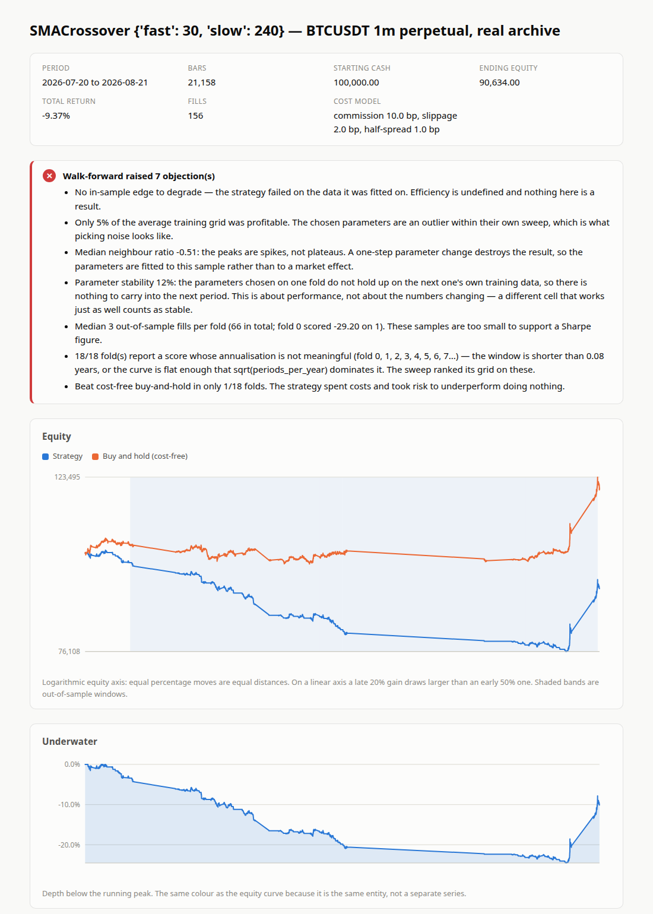
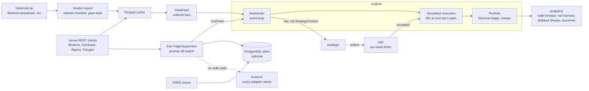
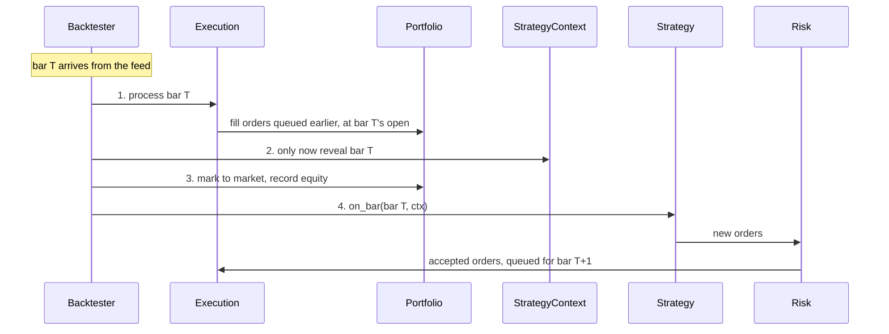

# trading_platform

A backtesting and paper-trading engine for systematic strategies, built to
**falsify** them rather than to find ones that look good. It covers crypto spot
and perpetuals, and US equities and ETFs. Options have an instrument model but
no strategy or pricing work yet.

Most backtesters make it easy to produce an attractive equity curve. This one is
built to make that hard. Orders always fill on the next bar, every fill pays
costs by default, money is `Decimal`, and a walk-forward run ends with a list of
reasons **not** to trust its own result. The strongest claim the platform will
make about a strategy is "failed to falsify, on this data, at this cost model."

> **This repository has never traded real money and cannot.** Every broker
> adapter raises, and `is_live` is `False` everywhere. Paper trading runs the
> same simulated execution engine that a backtest uses.



*Generated by the platform's own tearsheet renderer
(`analytics/tearsheet.py`) for an SMA crossover on 21,158 real BTCUSDT
1-minute perpetual bars, at the default cost model. The strategy lost 9.4%
while cost-free buy-and-hold gained. The walk-forward raised seven objections,
and the page prints them above the chart. A losing, rejected strategy is the
expected outcome here, and the page is designed to say so plainly.
[Full tearsheet](docs/images/tearsheet-btcusdt-sma.png) ·
[script that made it](docs/images/render_readme_tearsheet.py).*

## What it does

- **Lookahead-safe event loop.** An order submitted on bar T fills on bar T+1
  at that bar's open. This is enforced by the ordering of the event loop in
  `engine/backtester.py`, and 17 guards in `tests/test_lookahead.py` check it
  ([ADR 0001](docs/adr/0001-fill-on-next-bar.md)).
- **One instrument model.** Spot, perpetuals and options share one
  `Instrument` type. Derivatives are margined: a perpetual adds only
  unrealised P&L to equity, never its full notional.
- **Costs on every fill.** Commission (10 bp), slippage (2 bp) and half-spread
  (1 bp) by default. `ZERO_COST` exists only to isolate engine bugs and is never
  used as evidence.
- **Pre-trade risk limits.** Limits on order notional, position notional,
  gross leverage and orders per bar, plus a drawdown halt that still lets
  risk-reducing orders through. A rejected order never reaches execution.
- **Honest research tooling.** Walk-forward with a typed train/test split, a
  verdict layer that lists objections, a null harness that measures the
  pipeline's false-discovery rate on pure noise, and the Deflated Sharpe Ratio
  for the best of N trials.
- **Real data with its defects reported.** It imports a vendor archive and
  fetches from Binance, Coinbase, Alpaca, Polygon and FRED. Gaps stay gaps,
  nothing is interpolated, and an unknown FX rate or a date outside a
  calendar's range raises an error instead of being guessed.
- **Paper-trading stack.** A paper supervisor with a decision journal,
  reconcile-on-boot, a kill switch and a daily loss halt. A multi-source data
  collector writes to an optional PostgreSQL store and reconciles the sources
  against each other. A read-only operations page shows the state.
- **Measured defences.** `evals/` re-introduces 28 bugs this repository
  actually had and checks that the test suite still catches each one.

## Architecture

Dependencies point downward only. `core` imports nothing, and strategies see the
market only through a narrow `StrategyContext`.



Within each bar, the order of steps is what makes the engine safe:



Filling before observing is the key property. A signal computed from bar T
cannot fill until bar T+1. More detail is in
[docs/ARCHITECTURE.md](docs/ARCHITECTURE.md).

## Quick start

Requires Python 3.11 or newer. The only runtime dependency is `pyarrow`.
There is deliberately no pandas, numpy or matplotlib: money stays `Decimal`, and
the tearsheet draws its own SVG.

```bash
uv venv
uv pip install -e ".[dev]"
```

Run a backtest on synthetic data (about 5 seconds). It runs once with zero costs
as an engine check and once at realistic costs:

```bash
.venv/bin/python examples/run_backtest.py
```

Walk-forward on the real BTCUSDT archive. `historical.zip` (Binance perpetuals,
1-minute bars) is third-party market data, so it is not included in this
repository; supply your own copy, and without it the vendor tests skip. Import it
into the Parquet cache first; the importer prints the data's coverage and biases before it writes
anything:

```bash
.venv/bin/python scripts/import_vendor.py historical.zip --market um --interval 1m
```

```bash
.venv/bin/python examples/run_walk_forward_btc.py
```

Render an HTML tearsheet (written to `runs/`, which is gitignored):

```bash
.venv/bin/python examples/run_tearsheet.py
```

The optional PostgreSQL store, the data collector, the operations page and
paper trading are set up step by step in [docs/SETUP.md](docs/SETUP.md) and
[docs/RUNBOOK.md](docs/RUNBOOK.md). Install the `store` extra
(`uv pip install -e ".[dev,store]"`) for those.

## Writing a strategy

```python
from datetime import UTC, datetime
from decimal import Decimal

from trading_platform import (
    Backtester, RiskLimits, RiskManager, Strategy, crypto_spot, summarise, synthetic_walk,
)


class BuyTheDip(Strategy):
    name = "BuyTheDip"

    def on_bar(self, bar, ctx):
        closes = ctx.closes("BTCUSDT", lookback=20)
        if len(closes) < 20:  # wait for a full window
            return
        if bar.close <= min(closes) and ctx.is_flat("BTCUSDT"):
            ctx.target_notional("BTCUSDT", ctx.equity * Decimal("0.5"))
        elif bar.close >= max(closes) and not ctx.is_flat("BTCUSDT"):
            ctx.target_notional("BTCUSDT", Decimal("0"))


feed = synthetic_walk("BTCUSDT", datetime(2025, 1, 1, tzinfo=UTC), periods=500,
                      start_price=Decimal("40000"))
backtester = Backtester(
    instruments={"BTCUSDT": crypto_spot("BTCUSDT")},
    starting_cash=Decimal("100000"),
    risk_manager=RiskManager(limits=RiskLimits()),  # default CostModel applies
)
result = backtester.run(BuyTheDip(), feed)
print(result.summary())
print(summarise(result.equity_curve, periods_per_year=365).report())
```

A strategy reaches the market only through `ctx`: history, current price,
position, equity and order submission. It cannot reach the feed or the
portfolio object, so it has no way to read a future bar. A positive result on
synthetic data reflects the generator's drift; it is not evidence of an edge.

## Tests and quality

Measured on 2026-10-29 on a local machine, without a database:

| Check | Result |
|---|---|
| `pytest` | **1,270 passed, 117 skipped, 0 failed** (1,387 tests) |
| `tests/test_lookahead.py` | 17 guards on fill timing, all passing |
| Mutation eval (`--targeted`) | 22 of 28 past defects caught; 2 known, declared survivors; 4 need PostgreSQL and were not measured in this run |
| `mypy --strict` | clean |
| `ruff check` | clean |
| Size | about 22,600 lines of Python in `src/` |

```bash
.venv/bin/python -m pytest -q                            # full suite
.venv/bin/python -m pytest tests/test_lookahead.py -v    # the guards that matter most
.venv/bin/ruff check . && .venv/bin/mypy
.venv/bin/python scripts/run_mutation_eval.py --targeted # do the tests actually test?
```

The skipped tests are the PostgreSQL store suite. CI
([.github/workflows](.github/workflows)) runs it against a Postgres 16 service
and turns any skip into a failure, so the store layer cannot pass by not running.

A passing suite is not taken as proof. `scripts/run_mutation_eval.py` applies
each defect in `evals/defects/` (bugs this repository really had, such as a
market order filling at the bar's close, or a limit order filling at the bar's
low) and checks that some test fails. Writing that harness found tests that
could never fail, and a limit-fill leak that the whole suite had missed.

## Results so far

Every experiment is pre-registered in `harness/experiments/` with its
hypothesis and the condition that would disprove it, then run. The record so
far, as written in those files:

| Experiment | Data | Outcome |
|---|---|---|
| SMA crossover (E-011) | real BTCUSDT 1m | Rejected |
| ICT sweep reversal (E-016) | real BTCUSDT 1m | Rejected: 0 of 18 folds profitable, no in-sample edge |
| SMA crossover (E-018) | real SPY daily | Rejected by the harness despite a 1.67 out-of-sample Sharpe: a median of 1 fill per fold |
| SMA crossover (E-019, E-020) | real GLD / SLV daily | Rejected; on silver, 4 of 8 folds hit the drawdown halt |
| BTC→altcoin 1-minute lead (E-014) | real archive | Rejected |
| ML pipeline on pure noise (E-017) | synthetic noise | Validated: no edge found where none exists |
| Plateau-aware parameter stability (E-015) | synthetic | Promising; decision pending ([ADR 0009](docs/adr/0009-plateau-aware-stability.md)) |

No strategy has survived. That is the expected outcome for simple strategies,
and it shows the harness can say no. The tearsheet above reproduces E-011's
outcome on current code.

## How it was built

Built by Joel Shore with [Claude Code](https://claude.com/claude-code) as a
pair programmer; most commits were written with Claude. The repository includes
the Claude Code setup used to build it:

- **Subagents** (`.claude/agents/`): specialist reviewers such as
  `lookahead-auditor`, `risk-auditor`, `guard-auditor` (finds tests that cannot
  fail) and `adversarial-reviewer`, each assigned a model tier suited to the
  job.
- **Workflows** (`.claude/workflows/`): `gauntlet` runs every audit on a result,
  then passes each finding to an independent reviewer told to refute it.
- **Hooks** (`.claude/hooks/`): block credential-shaped writes, flag any change
  to a cost or risk default, and refuse to end a session while a lookahead guard
  is failing.
- **Measurement** (`evals/`): the agents themselves are tested against the
  same defect corpus as the test suite. Prose instructions are not a control
  until they have been measured.

AI-written code gets the same treatment as any other result here: it is
reviewed by agents told to break it, and the suite is checked by mutation.

## Project layout

```
src/trading_platform/
  core/        types, instruments (margin), events, FX, credentials   imports nothing
  data/        feeds, Parquet cache, vendor import, venue clients, synthetic data
  engine/      backtester (the event loop), execution, portfolio
  strategy/    Strategy, StrategyContext, example strategies, ICT patterns
  risk/        pre-trade limits, drawdown halt, leverage
  analytics/   metrics, walk-forward, null harness, multiplicity, tearsheet
  ml/          features, labels, purged splits, baseline (gated)
  live/        paper supervisor, stream bridge, recorder, journal, replay
  collect/     multi-source capture and reconciliation
  store/       optional PostgreSQL store and migrations
  brokers/     Broker protocol; every adapter raises
examples/      runnable backtests and walk-forwards
scripts/       data import and fetch, paper runner, collector, ops page, evals
tests/         pytest suite; test_lookahead.py guards the fill timing
evals/         the corpus of this repository's own defects
harness/       audits, experiment records, ticket log
docs/          architecture, setup, runbook, roadmap, ADRs
```

## What I learned

- **The bugs that matter don't crash.** A one-bar lookahead or a
  double-counted derivative notional produces a plausible equity curve, not an
  error. Every perpetual result here was retracted once when a margin bug was
  found; the retraction is kept in `docs/ROADMAP.md`.
- **A green suite can hide broken tests.** Thirteen tests here were found to
  be unable to fail (recorded in `harness/FINAL_AUDIT.md`). Mutation testing against real past defects found them;
  more tests would not have.
- **Data has to be checked.** The vendor archive was stamped at bar open, not
  close. Loading it as-is would have been a silent one-bar lookahead. This was
  found from the data itself: the trading burst at funding settlement lands
  on the bar stamped `:00`.
- **Annualised metrics lie on flat curves.** A strategy flat 94% of the time
  reported an annualised Sharpe of 12.8. The metrics layer now warns when that
  happens.

## What's next

From [harness/FINAL_AUDIT.md](harness/FINAL_AUDIT.md) and
[docs/ROADMAP.md](docs/ROADMAP.md):

- Run the collector and paper supervisor continuously on a VPS. Nothing has
  run continuously yet, and the Alpaca and Polygon clients are unverified
  against the live APIs.
- 30 days of paper trading with the daily review loop.
- Model funding on paper so perpetual strategies can be evaluated with carry.
- A human decision on ADR 0009.

Live trading is not planned. It would need credentials outside the repository,
a kill switch, venue-side loss limits, full order audit logging, a written
incident procedure and a recorded decision.

## Documentation

| Document | Contents |
|---|---|
| [CLAUDE.md](CLAUDE.md) | House rules and engineering invariants |
| [docs/SETUP.md](docs/SETUP.md) | Local setup, start to finish |
| [docs/ARCHITECTURE.md](docs/ARCHITECTURE.md) | Event loop, dependency direction, extension points |
| [docs/ROADMAP.md](docs/ROADMAP.md) | The lab notebook, retractions included |
| [docs/RUNBOOK.md](docs/RUNBOOK.md) | Running the collector and paper trading |
| [docs/adr/](docs/adr/) | Architecture decision records |
| [evals/README.md](evals/README.md) | Measuring the test suite and the agents |
| [harness/FINAL_AUDIT.md](harness/FINAL_AUDIT.md) | Scored self-audit |
